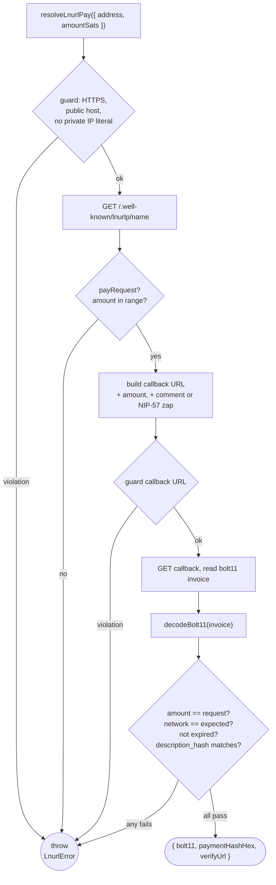
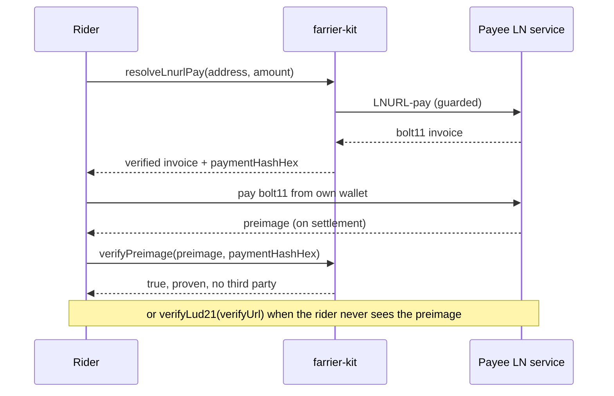

# farrier-kit

[](https://github.com/forgesworn/farrier-kit/actions/workflows/ci.yml)
[](https://primal.net/p/npub1mgvlrnf5hm9yf0n5mf9nqmvarhvxkc6remu5ec3vf8r0txqkuk7su0e7q2)
[](./LICENSE)

Lightning payment primitives that work anywhere. A farrier shoes working animals
for the road. This kit shoes your payment paths.

Reach for farrier-kit when an app needs to read and verify Lightning payment data
without running a node. Decode a BOLT-11 invoice, resolve a Lightning Address to
an invoice for an exact amount, and prove a payment settled. It runs in the
browser and in Node from one codebase, depends only on
[`@noble/hashes`](https://github.com/paulmillr/noble-hashes), and ships
[language-neutral conformance vectors](./CONFORMANCE.md) so a Kotlin or Swift port
can verify payments the same way.

It is not a wallet and not a node client. It holds no keys and moves no money. It
decodes, resolves, and verifies.

**[Try it without installing anything](https://farrier-kit.forgesworn.dev)**: the
bench runs this library in your browser: decode an invoice, prove a preimage, gate
a URL, and run the conformance vectors against the same bundle npm would give you.

## Modules

| Import | What it does |
|--------|--------------|
| [`farrier-kit/bolt11`](#bolt11) | Decode a BOLT-11 invoice: payment hash, amount, description, expiry, network. The bech32 checksum is verified, the invoice signature is not, and you do not need a node library to read two fields. |
| [`farrier-kit/preimage`](#preimage) | `payment_hash = SHA-256(preimage)`: generate, hash, verify in constant time. |
| [`farrier-kit/lnurl`](#lnurl) | Lightning Address to invoice (LUD-06/16), LUD-21 verify, capability probing. The fetch is SSRF-guarded and the invoice you get back is checked for amount, network, expiry, and description-hash. |
| [`farrier-kit/http`](#http) | `fetchJson` with a hard timeout, a response-size cap, and a redirect default that does not bounce you inward. |
| [`farrier-kit/node`](#node) | Node-only. A DNS-pinned `fetch` for resolving untrusted LNURL hosts on a server: it resolves once, refuses any private answer, and pins the socket to the approved address so a rebinding race cannot swap in an internal one. |
| `farrier-kit` (root) | Re-exports every export of `bolt11`, `preimage`, `http` and `lnurl`, values and types, and nothing from `node`. It stays browser-safe. `createPinnedFetch` and `PinnedFetchError` are only available from `farrier-kit/node`. The [API reference](#api-reference) lists each name. |

## Install

```bash
npm install farrier-kit
```

Node 18 or newer. Dual ESM and CJS, with TypeScript types. No configuration and no
build step in the consumer.

## Quickstart

This runs as written. The invoice is the `with-description-and-expiry` vector from
[`vectors/bolt11.json`](./vectors/bolt11.json): a mainnet invoice for 250,000 sats
with a synthetic zero signature, so it is for testing and can never be paid.
`decodeBolt11` does not read the signature, but a signature-verifying decoder will
reject this one.

```js
import { decodeBolt11, verifyInvoiceCommitment } from 'farrier-kit/bolt11'
import { generatePreimage, computePaymentHash, verifyPreimage } from 'farrier-kit/preimage'

const invoice =
  'lnbc2500u1pj48ugqpp55xs6rgdp5xs6rgdp5xs6rgdp5xs6rgdp5xs6rgdp5xs6rgdp5xssdqdxysxxmmxvejk2xqzpuqqqqqqqqqqqqqqqqqqqqqqqqqqqqqqqqqqqqqqqqqqqqqqqqqqqqqqqqqqqqqqqqqqqqqqqqqqqqqqqqqqqqqqqqqqqqqqqqqqqqqqqq02rq0p'
// The payment_hash you expect the invoice to commit to, from your own records.
const expectedHash = 'a1a1a1a1a1a1a1a1a1a1a1a1a1a1a1a1a1a1a1a1a1a1a1a1a1a1a1a1a1a1a1a1'

const inv = decodeBolt11(invoice)
inv.amountMsats // 250000000n
inv.description // '1 coffee'

// Before paying: the hash and the exact amount must both match (mainnet is the default).
const check = verifyInvoiceCommitment({ bolt11: invoice, paymentHash: expectedHash, expectedMsats: 250000000n })
if (!check.ok) throw new Error(check.reason)

// After paying: the counterparty reveals the preimage. A preimage and its hash are
// both 64-character hex strings. Here we mint our own pair to show the shape.
const preimage = generatePreimage()
const paymentHash = computePaymentHash(preimage)
verifyPreimage(preimage, paymentHash) // true
```

## Design rules

These are the constraints the library holds itself to, and CI enforces the first
two.

1. One codebase for the browser and Node. Nothing imports from `node:`. CI greps
   for it and bundles the output with `esbuild --platform=browser` to prove it.
   `@noble/hashes` is the only runtime dependency.
2. Dual ESM and CJS. Use `import` or `require`, with any bundler.
3. `fetch` is a parameter you can pass in, never an ambient assumption.
4. Amounts are explicit. Millisatoshis are `bigint`. `amountSats` is set only when
   the amount divides exactly, and flooring is its own named call
   (`msatsToSatsFloor`), so a sub-satoshi remainder can never disappear on you.
5. Checked against independents. Every invoice fixture is cross-validated against
   `light-bolt11-decoder` and the BOLT-11 spec vector, preimage hashing against a
   second SHA-256, and the whole verifiable surface is pinned by
   [conformance vectors](./CONFORMANCE.md).
6. Safe by default. The LNURL path refuses non-HTTPS, credentials, private IP
   literals (a hostname that resolves inward needs `createPinnedFetch`),
   redirects, and oversized bodies without being asked.

## How resolution and verification fit together

`resolveLnurlPay` is a pipeline. Every network hop is SSRF-guarded, and the
invoice the payee returns is decoded and checked against what you asked for before
you ever see it.



The settlement lifecycle is non-custodial. The operator advertises and verifies,
and the rider pays the payee directly.



## bolt11

```js
import { decodeBolt11, verifyInvoiceCommitment } from 'farrier-kit/bolt11'

// `invoice` and `expectedHash` are the values defined in the Quickstart.
const inv = decodeBolt11(invoice)
inv.paymentHashHex // 'a1a1…a1a1' (lowercase hex)
inv.amountMsats    // 250000000n  (bigint, null when amountless)
inv.amountSats     // 250000      (null when not a whole satoshi)
inv.network        // 'bc' | 'tb' | 'tbs' | 'bcrt' | 'sb'
inv.expirySeconds  // 60 (spec default 3600 when absent)

// Pre-payment check. The payment_hash on its own is not enough: the payee picks
// the preimage, so they can mint a second invoice with the same hash for any
// amount. Pass expectedMsats, and rely on the default mainnet network, when money
// is about to move.
const check = verifyInvoiceCommitment({
  bolt11: invoice,
  paymentHash: expectedHash,
  expectedMsats: 250000000n,
})
if (!check.ok) throw new Error(check.reason)
```

`decodeBolt11` does not verify the invoice signature or parse route hints. It
checks the bech32 checksum and reads the fields, so a decoded invoice is not
authenticated as coming from any particular node. It is a reader, not a wallet.

`decodeBolt11` throws a `Bolt11Error` with a machine-readable `code` on anything
that is not a checksum-valid invoice carrying a payment hash. When "not an
invoice" is expected input, use `tryDecodeBolt11`, which returns `null`, or the
single-field helpers `bolt11PaymentHash` and `bolt11AmountMsats`.

`verifyInvoiceCommitment` takes these options and returns a verdict
`{ ok, verified?, reason?, amountMsats?, network? }`:

| Option | Default | Meaning |
|--------|---------|---------|
| `bolt11` | required | The invoice string. |
| `paymentHash` | required | The expected payment hash, 64-character hex, either case. |
| `expectedMsats` | none | `bigint` or safe-integer `number`. When given, the invoice amount must equal it exactly and an amountless invoice is refused. Without it the amount is not checked, so read `verdict.amountMsats` yourself. |
| `network` | `'bc'` | The required network. Pass `null` to accept any (dev and regtest only). |
| `requireDecodable` | `true` | When `false`, an undecodable invoice returns `{ ok: true, verified: false }`, deferred to the preimage check. Never treat that as safe to pay. |

It checks hash, network and amount only. It does not check expiry or the
description hash; `resolveLnurlPay` does both.

`Bolt11Error.code` is one of:

| Code | Thrown when |
|------|-------------|
| `NOT_INVOICE` | The input does not start with `ln`. |
| `BAD_BECH32` | Not valid bech32: charset, mixed case or checksum. |
| `BAD_HRP` | The prefix is not `ln`, a network (`bc`, `tb`, `tbs`, `bcrt`, `sb`) and an optional amount. |
| `BAD_AMOUNT` | A pico-BTC amount is not a whole millisatoshi, the amount exceeds the 21M BTC supply, or `msatsToSatsFloor` got a non-finite or negative value. |
| `OVERFLOW` | `msatsToSatsFloor` result exceeds `Number.MAX_SAFE_INTEGER` sats. |
| `TRUNCATED` | Shorter than a timestamp plus a signature. |
| `BAD_TAG` | A tag runs past the end of the invoice, or a numeric tag is too long, out of range or does not regroup to bytes. |
| `BAD_PAYMENT_HASH` | The `p` tag is not a clean 32-byte field. |
| `MISSING_PAYMENT_HASH` | The invoice carries no `p` tag. |

## preimage

Every preimage and payment hash in this module is a 64-character hex string (32
bytes), never a `Uint8Array`. Input may be either case and output is always
lowercase.

```js
import { generatePreimage, computePaymentHash, verifyPreimage } from 'farrier-kit/preimage'

const preimage = generatePreimage()               // string, 64-char hex
const paymentHash = computePaymentHash(preimage)  // string, 64-char hex
// ... the invoice settles and the counterparty reveals the preimage ...
const revealed = preimage // in real use, the string the counterparty handed you
verifyPreimage(revealed, paymentHash) // constant-time true or false
```

```ts
isValidHex64(value: string): boolean
generatePreimage(entropy?: string): string
computePaymentHash(preimage: string): string
verifyPreimage(preimage: string, expectedHash: string): boolean
explainPreimage({ preimage, paymentHash }: { preimage: string; paymentHash: string }): { ok: boolean; reason?: string }
```

`generatePreimage` and `computePaymentHash` throw a plain `Error` on a value that
is not 64-character hex; `generatePreimage(entropy)` returns the lowercased
`entropy` rather than random bytes. `verifyPreimage` never throws: it returns
`false` for malformed input as well as for a mismatch. Use `explainPreimage` when
you want the reason.

Naming is not uniform across modules, but the type is. `paymentHash` (in
`verifyInvoiceCommitment` and `explainPreimage`; `verifyPreimage` calls it
`expectedHash`) and `paymentHashHex` (on a decoded invoice, on a resolved LNURL
result and in `verifyLud21`) are the same 64-character hex string.

The signatures line up with [escrow-kit](https://github.com/forgesworn/escrow-kit),
so that library can adopt these by re-export.

## lnurl

```js
import { resolveLnurlPay, verifyLud21 } from 'farrier-kit/lnurl'

// Lightning Address to a bolt11 invoice for an exact amount. The invoice has been
// decoded and checked: the amount equals the request, mainnet by default, not
// expired, and for zaps the description_hash commits to the zap request.
const paid = await resolveLnurlPay({ address: 'alice@wallet.example.com', amountSats: 21000 })
paid.bolt11         // hand to any wallet
paid.paymentHashHex // verify the revealed preimage against this
paid.verifyUrl      // LUD-21, origin-bound to the callback, null when not offered

// LUD-21 settlement check. verified is true only when a returned preimage
// cryptographically matches. settled on its own is the service's word, not proof.
if (paid.verifyUrl) {
  const status = await verifyLud21({ verifyUrl: paid.verifyUrl, paymentHashHex: paid.paymentHashHex })
  status.verified // boolean
}
```

`resolveLnurlPay` resolves to `{ address, amountMsats, amountSats, bolt11,
paymentHashHex, verifyUrl, zap, metadata }`. `address` is the canonical
lowercased form, or `null` when you passed `lnurlpUrl`. `amountMsats` is a
`bigint` and `amountSats` is `null` unless the amount is whole. `zap` is `true`
when your `nostr` zap request was attached to the callback. `metadata` is the
service's LUD-06 response:
`{ tag, callback, minSendable, maxSendable, commentAllowed, allowsNostr, nostrPubkey, metadata }`,
where `minSendable` and `maxSendable` are millisatoshis as `number` and the last
`metadata` is the raw JSON string that the description hash commits to.

`verifyLud21` resolves to `{ settled, preimage, verified }`: `settled` is whether
the service says the invoice is paid, `preimage` is what it returned (or `null`),
and `verified` is `true` only when `settled` is true, a preimage came back, you
passed `paymentHashHex`, and `SHA-256(preimage)` equals it.

### The invoice gate and its options

Amount is always checked and cannot be turned off. The other checks run by
default and each has one opt-out. The SSRF guard has no opt-out at all.

| Option | Default | Opt-out | Effect |
|--------|---------|---------|--------|
| `network` | `'bc'` (mainnet) | `network: null` | The invoice must be on this network, else `NETWORK_MISMATCH`. |
| `rejectExpired` | `true` | `rejectExpired: false` | An expired invoice throws `INVOICE_EXPIRED`. `expirySlackSeconds` (default `60`) is the clock-skew allowance and `nowSeconds` injects the clock. |
| `verifyDescriptionHash` | `true` | `verifyDescriptionHash: false` | When the invoice has an `h` tag and the service returned a metadata string, the tag must equal SHA-256 of that string, else `DESCRIPTION_HASH_MISMATCH`. For a zap (`nostr` attached) the `h` tag is required and must equal SHA-256 of the zap request. An invoice with no `h` tag passes for a non-zap. |
| `urlGuard` | none | omit it | An extra check on every URL, sync or async, run after the built-in guard. It adds to the guard and cannot replace it. It does not close DNS rebinding; use `createPinnedFetch` for that. |

`nostr` is a `string`: the JSON-encoded signed NIP-57 zap request. It is attached
only when the service sets `allowsNostr` and a `nostrPubkey`; otherwise it is
ignored. When a zap is attached, `comment` is not sent. `comment` is truncated to
the service's `commentAllowed`, counted in code points.

Pass either `amountSats` or `amountMsats` (a positive integer; `amountMsats` wins
if both are given), and either `address` or `lnurlpUrl` (`address` wins if both
are given). Network and HTTP failures from `fetchJson` propagate unwrapped
(`HttpError`, `ResponseTooLargeError`, a plain `Error` on timeout). The service's
response is capped at 256 KiB.

`LnurlError.code` is one of:

| Code | Thrown when |
|------|-------------|
| `BAD_ADDRESS` | Not `name@domain`, a local domain (`localhost`, `.local`, `.localhost`), or neither `address` nor `lnurlpUrl` given. |
| `BAD_URL` | A URL is not HTTPS, carries credentials, uses a local host (`localhost`, `.local`, `.internal`, `.localhost`, `.home.arpa`), is a private or reserved IP literal, or the callback is not a URL. |
| `BAD_AMOUNT` | `amountSats` or `amountMsats` is missing, not an integer, or not positive. |
| `SERVICE_ERROR` | The service answered `status: 'ERROR'`; the message is its `reason`. |
| `NOT_PAYREQUEST` | The endpoint's `tag` is not `payRequest`. |
| `NO_CALLBACK` | The LNURL-pay response has no callback. |
| `BELOW_MIN`, `ABOVE_MAX` | The amount is outside the service's `minSendable` or `maxSendable`. |
| `NO_INVOICE` | The callback returned no `pr`. |
| `BAD_INVOICE` | The returned invoice does not decode. |
| `AMOUNT_MISMATCH` | The invoice is amountless or for a different amount than requested. |
| `NETWORK_MISMATCH` | The invoice is on another network. |
| `INVOICE_EXPIRED` | The invoice has expired, beyond `expirySlackSeconds`. |
| `DESCRIPTION_HASH_MISMATCH` | The `h` tag does not commit to the metadata or the zap request. |

`createCapabilityProbe` answers "can this address take N sats, with a comment, as
a zap?" from metadata alone, without requesting an invoice:

```js
import { createCapabilityProbe } from 'farrier-kit/lnurl'

const probe = createCapabilityProbe({ cacheTtlMs: 300000, maxEntries: 1000 })
const cap = await probe.probe('alice@wallet.example.com')
// { ok, reason?, address, minSendable, maxSendable, commentAllowed, allowsNostr, nostrPubkey }
probe.invalidate('alice@wallet.example.com') // or invalidate() for everything
```

Its options are `fetchImpl`, `timeoutMs`, `urlGuard`, `cacheTtlMs` (default 5
minutes), `maxEntries` (default 1000, oldest evicted first) and `now`. A fetch or
guard failure comes back as `{ ok: false, reason }` and is cached too. Only an
unparseable address throws (`BAD_ADDRESS`).

## http

```js
import { fetchJson } from 'farrier-kit/http'

const body = await fetchJson('https://example.com/.well-known/lnurlp/alice', {
  timeoutMs: 5000,   // default 8000
  maxBytes: 262144,  // default 10 MiB, metered and aborted mid-flight
  fetchImpl: myFetch,// optional, defaults to globalThis.fetch
})
```

`fetchJson<T = unknown>(url: string, options?: FetchJsonOptions): Promise<T>`.
The remaining options are `method` (default `'GET'`), `headers`
(`Record<string, string>`, merged over `accept: application/json`) and `body`.
An object `body` is JSON-serialised and gets `content-type: application/json`
unless you set one; a string `body` is sent as is. A non-2xx response throws
`HttpError` with the numeric `status`, an oversized body throws
`ResponseTooLargeError`, and a timeout throws a plain `Error`.

`fetchJson` sets `redirect` to `'manual'` by default. For a payments util that is
the safe choice, since a public host should not be able to 3xx-bounce a request
inward. Pass `redirect: 'follow'` if you want redirects.

## node

Node-only. `createPinnedFetch` returns a `fetch` you pass as `fetchImpl` to
`resolveLnurlPay`, `verifyLud21` or `createCapabilityProbe`. It is the server-side
answer to DNS rebinding (see the SSRF section for why a URL check alone is not
enough).

```js
import { createPinnedFetch } from 'farrier-kit/node'
import { resolveLnurlPay } from 'farrier-kit/lnurl'

const pinnedFetch = createPinnedFetch() // rejects any private/reserved answer

const invoice = await resolveLnurlPay({
  address: 'alice@example.com',       // untrusted, payee-controlled
  amountSats: 1000,
  fetchImpl: pinnedFetch,             // metadata, callback and verify URLs all pinned
})
```

It resolves the hostname once, rejects the request if any answer is private,
loopback, link-local, reserved, documentation-only or multicast, and connects the
socket to the one approved address by overriding its DNS lookup, so there is no
second resolution to race. The TLS SNI, certificate check and HTTP Host header
stay on the original hostname. It never follows redirects, and it is HTTPS-only:
the pin proves you reached the address you resolved, which means nothing on a
cleartext channel. Pass `allowPrivate: true` and `allowHttp: true` only for local
development against regtest or localhost.

`createPinnedFetch(options?: CreatePinnedFetchOptions): typeof fetch` takes:

| Option | Default | Use |
|--------|---------|-----|
| `allowPrivate` | `false` | Permit private and reserved targets. Local development only. |
| `allowHttp` | `false` | Permit plaintext `http:` URLs. Local development only, beside `allowPrivate`. |
| `resolve` | `node:dns` lookup of all records | `(hostname: string) => Promise<LookupAddress[]>`. Supply your own resolver (DoH, a fixed allowlist) or a stub in tests. The result is still checked and pinned. |
| `isBlockedAddress` | the core private and reserved classifier | `(address: string) => boolean`. Replace the notion of a blocked address. |
| `requestImpl` | `node:http` or `node:https` by protocol | A low-level request function, as a testing seam or to supply a custom agent. |

A request that is refused throws a `PinnedFetchError` with a `code`:

| Code | Thrown when |
|------|-------------|
| `BAD_PROTOCOL` | The URL is `http:` without `allowHttp`, or neither `http:` nor `https:`. |
| `DNS_ERROR` | The hostname could not be resolved. |
| `NO_ADDRESS` | The resolver returned no addresses. |
| `PRIVATE_ADDRESS` | Any resolved address is private or reserved. |

## SSRF: what the guard does and does not do

`resolveLnurlPay` fetches from payee-controlled domains, so it is an SSRF surface.
The built-in guard rejects an HTTPS violation, credentials in the URL,
`localhost`, `.local` and `.internal` hosts (trailing dots included), and any IP
literal in a private or reserved range. That covers IPv4 and every IPv6 form the
URL parser normalises to: mapped `::ffff:*`, NAT64, 6to4, Teredo, link-local,
site-local, ULA, and multicast.

Here is what the core cannot do on its own. It cannot stop a hostname that
resolves to a private address, such as an attacker A-record pointing at
`10.0.0.5`, or a DNS-rebinding race. Browsers cannot resolve DNS at all, so this
pinning is a server-only job; a browser should never resolve an untrusted address.

On a server, use `createPinnedFetch` from [`farrier-kit/node`](#node):

```js
import { createPinnedFetch } from 'farrier-kit/node'
import { resolveLnurlPay } from 'farrier-kit/lnurl'

await resolveLnurlPay({ address, amountSats, fetchImpl: createPinnedFetch() })
```

Why not just a `urlGuard` that resolves DNS and checks the address? Because that
is a check, and the fetch that follows is a separate connection that resolves DNS
again. Between the two lookups the answer can change: public when you check,
private when you connect. That gap is DNS rebinding, and a check-then-fetch cannot
close it. `createPinnedFetch` does, by being the connection: it validates the
address it is about to use and pins the socket to it.

The `urlGuard` hook still exists for an extra check on every URL (an allowlist,
say). It may be sync or async and runs after the built-in checks, but it does not
replace `createPinnedFetch` for rebinding.

## API reference

Every export, by subpath. The root `farrier-kit` import re-exports everything below
except the `farrier-kit/node` section.

### farrier-kit/bolt11

```ts
decodeBolt11(invoice: string): DecodedBolt11                 // throws Bolt11Error
tryDecodeBolt11(invoice: string): DecodedBolt11 | null
bolt11PaymentHash(bolt11: string): string | null             // lowercase hex
bolt11AmountMsats(bolt11: string): number | null             // null if amountless, undecodable or above Number.MAX_SAFE_INTEGER
msatsToSatsFloor(msats: bigint | number): number             // explicit flooring; throws Bolt11Error
verifyInvoiceCommitment(opts: {
  bolt11: string
  paymentHash: string
  expectedMsats?: bigint | number
  network?: Bolt11Network | null                              // default 'bc'
  requireDecodable?: boolean                                  // default true
}): CommitmentVerdict
class Bolt11Error extends Error { code: string }
const BOLT11_DEFAULT_EXPIRY_SECONDS = 3600

type Bolt11Network = 'bc' | 'tb' | 'tbs' | 'bcrt' | 'sb'
interface DecodedBolt11 {
  network: Bolt11Network
  amountMsats: bigint | null
  amountSats: number | null                                   // only when the amount is whole
  paymentHashHex: string
  paymentSecretHex: string | null
  description: string | null
  descriptionHashHex: string | null
  timestamp: number                                           // seconds since epoch
  expirySeconds: number                                       // 3600 when the invoice has no x tag
  minFinalCltvExpiry: number | null
}
interface CommitmentVerdict {
  ok: boolean
  verified?: boolean                                          // true when the invoice was decoded and compared
  reason?: string
  amountMsats?: bigint | null
  network?: Bolt11Network
}
```

### farrier-kit/preimage

```ts
isValidHex64(value: string): boolean
generatePreimage(entropy?: string): string
computePaymentHash(preimage: string): string
verifyPreimage(preimage: string, expectedHash: string): boolean
explainPreimage(args: { preimage: string; paymentHash: string }): PreimageVerdict

interface PreimageVerdict { ok: boolean; reason?: string }
```

`explainPreimage` returns `{ ok: true }` or `{ ok: false, reason }`, where `reason`
is one of:

- `preimage must be 32-byte hex`
- `payment_hash must be 32-byte hex`
- `preimage does not hash to the committed payment_hash`

### farrier-kit/lnurl

```ts
isLightningAddress(handle: string): boolean
parseLightningAddress(address: string): LightningAddress     // throws LnurlError BAD_ADDRESS
lnurlPayUrl(parts: { name: string; domain: string }): string // the LUD-16 well-known URL
resolveLnurlPay(opts: ResolveLnurlPayOptions): Promise<ResolvedLnurlPay>
verifyLud21(opts: {
  verifyUrl: string
  paymentHashHex?: string
  fetchImpl?: typeof fetch
  timeoutMs?: number
  urlGuard?: (url: URL) => void | Promise<void>
}): Promise<Lud21Result>
createCapabilityProbe(opts?: {
  fetchImpl?: typeof fetch
  timeoutMs?: number
  urlGuard?: (url: URL) => void | Promise<void>
  cacheTtlMs?: number                                         // default 300000
  maxEntries?: number                                         // default 1000
  now?: () => number                                          // ms, default Date.now
}): CapabilityProbe
assertResolvableUrl(input: string | URL): URL                 // HTTPS, public host, no credentials; throws LnurlError BAD_URL
isPrivateIpLiteral(hostname: string): boolean
class LnurlError extends Error { code: string }

interface LightningAddress { address: string; name: string; domain: string }  // lowercased
interface ResolveLnurlPayOptions {
  address?: string                                            // name@domain
  lnurlpUrl?: string                                          // a direct LUD-06 URL instead
  amountSats?: number
  amountMsats?: bigint | number
  comment?: string
  nostr?: string                                              // JSON-encoded signed NIP-57 zap request
  fetchImpl?: typeof fetch
  timeoutMs?: number
  urlGuard?: (url: URL) => void | Promise<void>
  network?: Bolt11Network | null                              // default 'bc'
  rejectExpired?: boolean                                     // default true
  expirySlackSeconds?: number                                 // default 60
  verifyDescriptionHash?: boolean                             // default true
  nowSeconds?: () => number
}
interface ResolvedLnurlPay {
  address: string | null
  amountMsats: bigint
  amountSats: number | null
  bolt11: string
  paymentHashHex: string
  verifyUrl: string | null
  zap: boolean
  metadata: LnurlPayMetadata
}
interface LnurlPayMetadata {
  tag: string
  callback: string
  minSendable: number                                         // msats
  maxSendable: number                                         // msats
  commentAllowed: number
  allowsNostr: boolean
  nostrPubkey: string
  metadata: string                                            // raw LUD-06 JSON string
}
interface Lud21Result { settled: boolean; preimage: string | null; verified: boolean }
interface LnurlPayCapability {
  ok: boolean
  reason?: string
  address: string
  minSendable: number
  maxSendable: number
  commentAllowed: number
  allowsNostr: boolean
  nostrPubkey: string
}
interface CapabilityProbe {
  probe(address: string): Promise<LnurlPayCapability>
  invalidate(address?: string): void
}
```

`isPrivateIpLiteral` is only sound on a URL-normalised hostname (what
`new URL(x).hostname` gives you). It does not catch `0x7f000001` or `2130706433`
in a raw string; feed such input through `new URL()` first.

### farrier-kit/http

```ts
fetchJson<T = unknown>(url: string, options?: FetchJsonOptions): Promise<T>
class HttpError extends Error { status: number }
class ResponseTooLargeError extends Error
const DEFAULT_TIMEOUT_MS = 8000
const DEFAULT_MAX_BYTES = 10485760                            // 10 MiB

interface FetchJsonOptions {
  fetchImpl?: typeof fetch
  timeoutMs?: number
  method?: string                                             // default 'GET'
  headers?: Record<string, string>
  body?: unknown                                              // objects are JSON-serialised, strings pass through
  redirect?: RequestRedirect                                  // default 'manual'
  maxBytes?: number                                           // default DEFAULT_MAX_BYTES
}
```

### farrier-kit/node

Node-only, and not re-exported from the root.

```ts
createPinnedFetch(options?: CreatePinnedFetchOptions): typeof fetch
class PinnedFetchError extends Error { code: string }

interface CreatePinnedFetchOptions {
  allowPrivate?: boolean                                      // default false
  allowHttp?: boolean                                         // default false
  resolve?: (hostname: string) => Promise<LookupAddress[]>    // node:dns LookupAddress
  isBlockedAddress?: (address: string) => boolean
  requestImpl?: typeof import('node:http').request
}
```

## Conformance and porting (Kotlin, Swift, Rust)

The pure, deterministic surface is pinned by language-neutral vectors in
[`vectors/`](./vectors), so a native port can be checked byte-for-byte against the
same contract the TypeScript reference passes. See
[CONFORMANCE.md](./CONFORMANCE.md). This is how the Android and GrapheneOS clients
on the roadmap verify payments the same way as the browser build. The vectors ship
in the npm package, and CI regenerates them from independent oracles and fails on
any drift.

## Security

farrier-kit had a full independent security review before its first release: three
reviewers plus a Codex cross-check. The SSRF guard, the invoice amount and network
gating, and the response caps were hardened as a result, each with a regression
test. Cryptography is [`@noble/hashes`](https://github.com/paulmillr/noble-hashes),
not hand-rolled. It has not had a paid third-party audit, so treat it accordingly
for high-value custody. Report issues via
[GitHub](https://github.com/forgesworn/farrier-kit/issues).

## Comparison

Most Lightning JS libraries either only decode an invoice, or are wallet and
payment toolkits that resolve a Lightning Address and hand you an invoice to pay.
farrier-kit sits in a different spot. It is the read-and-verify layer you run
before payment.

| Library | bolt11 decode | LNURL resolve | invoice gating¹ | SSRF guard | preimage / LUD-21 verify | sends / zaps | browser + Node | core deps |
|---|:--:|:--:|:--:|:--:|:--:|:--:|:--:|---|
| **farrier-kit** | ✓ | ✓ | ✓ all four | ✓ | ✓ | ✗ | ✓ | @noble only |
| [light-bolt11-decoder](https://github.com/fiatjaf/light-bolt11-decoder) | ✓ | ✗ | ✗ | – | ✗ | ✗ | ✓ | `@scure/base` |
| [bolt11](https://github.com/bitcoinjs/bolt11) (bitcoinjs) | ✓ +encode/sign | ✗ | ✗ | – | ✗ | ✗ | ~ native secp | heavy |
| [@getalby/lightning-tools](https://github.com/getAlby/js-lightning-tools) | ✓ | ✓ | ✗ | ✗ | ✓ | ✓ zaps/NWC/L402 | ✓ | zero-install (bundled) |
| [lnurl-pay](https://github.com/dolcalmi/lnurl-pay) | ✓ | ✓ | ~ amount + desc-hash | ✗ (accepts `localhost`) | ✓ | ✗ | ✓ | browserify tree |

¹ invoice gating means checking the invoice you got back against what you asked
for: amount, network, expiry, and description-hash.

What is actually different here. As far as we can tell, farrier-kit is the only JS
or TS library that guards LNURL and Lightning-Address resolution against SSRF.
Alby fetches the callback unchecked, and lnurl-pay's URL check accepts
`localhost`. It is also the only one that gates the resolved invoice on all four
of amount, network, expiry, and description-hash. lnurl-pay already checks amount
and description-hash, which is good prior art, but not network or expiry, and does
not guard the fetch. Alby checks none of the four. The value is the combination:
guarded resolution, the full four-way gate, and preimage verify, in the browser
and Node from an @noble-only core.

Where the others win, and where you should use them. If you need a focused NIP-47
client, use [`@forgesworn/nwc-kit`](https://github.com/forgesworn/nwc-kit) and
keep farrier-kit on both sides of the payment to verify the invoice and returned
preimage. If you need a broader wallet toolkit, WebLN, NIP-57 zaps, boostagrams,
or L402 helpers, [@getalby/lightning-tools](https://github.com/getAlby/js-lightning-tools)
covers that wider surface. None of those jobs belong in farrier-kit. If you only need to decode,
[light-bolt11-decoder](https://github.com/fiatjaf/light-bolt11-decoder) is smaller
and more battle-tested, and Alby bundles it anyway. If you need to create or sign
invoices, use [bolt11](https://github.com/bitcoinjs/bolt11). farrier-kit takes the
narrow, security-critical slice those leave open: safely verifying what someone
handed you.

## Roadmap

Shipped so far: the v1 core (`/bolt11`, `/preimage`, `/lnurl`, `/http`, `/node`), an
independent security review, and language-neutral conformance vectors. Next up is
a Kotlin port checked against the vectors, so verification is identical on native
mobile. Wallet communication remains a separate package so this core stays small,
portable, and independently auditable.

See [ROADMAP.md](./ROADMAP.md) for the full plan and [RELEASING.md](./RELEASING.md)
for how releases are cut.

## Support

For issues and feature requests, see [GitHub Issues](https://github.com/forgesworn/farrier-kit/issues).

If farrier-kit is useful to you, a tip is always welcome:

- Lightning: `profusemeat89@walletofsatoshi.com`
- Nostr zaps: `npub1mgvlrnf5hm9yf0n5mf9nqmvarhvxkc6remu5ec3vf8r0txqkuk7su0e7q2`

## Licence

MIT
